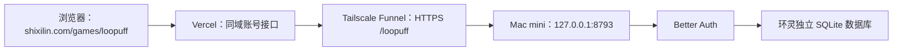

# 环灵账号服务：Mac mini 部署方案

2026-10-24，小主人确认环灵的账号后端使用自己的 Mac mini。
采用连珠馆已有的 Better Auth 技术路线，环灵独立存放账号与会话。
此文也是后续自有网站的复用依据；项目参数和真实验证结果必须重新核对。

## 访问链路



- 前端继续使用既有 Vercel 发布，游戏静态资源不经家中网络。
- 浏览器只访问游戏的同域接口，不直接接触数据库或后端密钥。
- Vercel 仅转发环灵的会话 Cookie；不转发个人官网其他产品的 Cookie。
- Mac 服务只绑定回环地址，公网入口只暴露明确的账号 API 和健康检查。
- 注册、密码校验、会话和退出使用 Better Auth；密码不在前端存储中保存。
- 学习进度目前仍在浏览器本地，账号上线不自动代表已实现云端存档或排行榜。

## 与连珠馆的关系

连珠馆的账号认证是 Better Auth，数据存于 Supabase 托管的 PostgreSQL，
生产应用在 Vercel；Mac mini 承担其自托管 CI。环灵复用认证方法和部署经验，
不复用连珠馆的用户表、会话 Cookie、数据库连接或应用密钥。

环灵前期采用独立 SQLite，减少外部数据库依赖。今后需要多机运行或更高并发时，
迁移数据库和账号 API，保持前端同域接口稳定。

## 本项目参数

| 参数 | 环灵取值 |
| --- | --- |
| 正式前端 | `https://shixilin.com/games/loopuff/` |
| 浏览器接口 | `/games/loopuff/api/account/` |
| Mac 服务端口 | `127.0.0.1:8793` |
| Funnel 路径 | `/loopuff`，与现有游戏路径并存 |
| 运行目录 | Mac 当前用户的 `~/loopuff` |
| 账号数据 | `~/loopuff/data/loopuff.sqlite`；不进入 Git 或前端构建 |
| 会话前缀 | `loopuff`，与其他网站隔离 |
| 认证库 | Better Auth `1.7.12`，通过锁文件固定依赖 |
| Node | Mac 当前为 `24.18.0`，支持内置 SQLite |
| 密钥配置 | `LOOPUFF_AUTH_SECRET`，只在服务器私有配置中保存 |

后端提供 session 查询、邮箱密码注册、登录、退出。服务不可达、密码错误和
限流分别返回可重试或可纠正的错误，不能把失败当作登录成功。

## 后续项目复用方式

1. 在项目自己的仓库保存前端、账号服务、锁文件和部署说明。
2. 先检查 Mac 上现有服务与端口，为新项目分配独立端口、运行目录和数据文件。
3. 单独生成应用密钥和 Cookie 前缀，设置准确的可信来源域名。
4. 增加项目自己的同域转发与 Funnel 路径，保留既有游戏入口。
5. 以独立 LaunchAgent 管理进程；只重启本项目，不重启共享网络或其他应用。
6. 先完成本机注册、登录、会话恢复、退出和重启恢复，再验证正式域名。
7. 对数据文件做一致性备份；保留可恢复副本，并通过临时数据库验证恢复。
8. 交付记录源码提交、远端同步、部署来源、健康检查和真实验证范围。

## 验证与恢复记录

2026-10-24 已实际执行：

- Mac 上运行 Node 24.18.0，服务仅监听 `127.0.0.1:8793`。
- `com.loopuff.account` 管理账号进程；`com.loopuff.backup` 每日 04:30 运行备份。
- 私有配置 `.env.local` 和数据库权限为 `600`，运行、数据目录为 `700`。
- Funnel 的 `/loopuff` 已启用，既有 `/one-cue`、`/popolo` 保持原端口。
- 账号服务 11 项测试通过；项目 37 项测试与静态构建通过。
- 通过本地同域转发，真实完成测试账号注册、登录、错误密码拒绝、退出。
- 单独重启账号进程后，原会话仍有效。
- `node backup.mjs` 使用 SQLite 一致性备份，执行完整性检查。
- 备份复制到临时数据库后，通过账号服务恢复同一会话；测试未覆盖线上库。
- 11 种语言的账号表单已检查 480 CSS px 窄屏尺寸；未发现横向溢出。
- 正式首页已匹配本次构建。官网转发需要接口末尾斜杠，客户端固定为 `/api/account/`，避免重定向时丢失游戏前缀。
- 正式域名的真实注册、登录、错误密码拒绝、退出、进程重启会话恢复、临时备份库会话恢复均已通过。测试使用专用 `.invalid` 账号，不向真实邮箱发信。

备份位于 `~/loopuff-backups/YYYY-MM-DD/accounts.sqlite`。当前备份与服务在同一台
Mac，不代表异地容灾；定时备份已配置，本轮实际手动运行并验证。
账号支持邮箱密码注册和登录；邮箱验证、找回密码和云端学习进度尚未实现。

### 运行与恢复

在 Mac 的 `~/loopuff` 执行：

```sh
npm ci --omit=optional --ignore-scripts --no-audit --no-fund
npm test
python3 install-mac.py
node backup.mjs
launchctl kickstart -k gui/$(id -u)/com.loopuff.account
```

安装脚本仅在配置不存在时生成密钥；不覆盖原有密钥，不操作其他应用。
服务版本回滚只替换应用源文件并重启本项目标签，保留数据库、配置与备份。
SQLite 结构升级前先备份；先在临时库演练恢复，再决定维护时间窗口。
自启属于当前 Mac 用户的 LaunchAgent，依赖该用户登录；不是开机前的系统服务。

## 首页设计的复用边界

- 本轮沿用内页的米白、鼠尾草绿与深绿文字，移除文字阴影。
- 底色保持满幅；标题、说明与操作集中在上方，代码示例改为一行轻量信息，飞机与装饰场景在下方独立航道内。
- 航道桌面高度 190—280px、手机 170px。场景不作整屏背景，不在正文和按钮后堆叠浮岛。桌面标题上限 64px，飞机 132×152px；手机飞机 106×130px。
- 飞机坐标只相对于航道；拖动、键盘、语言切换和尺寸变化都即时约束完整飞机的边界。容器过小或无合法位置时隐藏，恢复空间后重新显示，禁止回退到可能重叠的默认坐标。
- 已实测向标题区、航道边缘拖动与键盘归位；11 种语言在 480 CSS px 下均未越界、未与正文重叠。整体测试 43 项通过，其中飞机边界回归 9 项。
- 标题居中，“星球”保留绿色；使用已选飞机原图，无外圈，支持键盘与拖动。
- 去除植物装饰，改用航标、信号和传送门；保留课程、游乐场与进度入口。
- 这些是环灵当前方向，不能作为其他网站默认模板；最终审美认可由小主人确认。

回滚时先退回上一版账号接口与服务版本，保留账号数据库和应用密钥。
恢复测试使用临时库，不覆盖正在使用的库；数据库结构升级前先备份。
